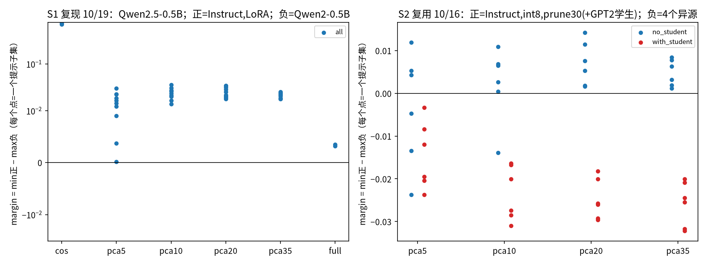

# 方法 A 基线重跑：官方 DiffIPMetric 作用于真实 LLM 逐层 hidden

日期：2026-10-22（UTC+8）。环境：box，只用 CPU，`/workspace/papers/.venv`（numpy/scipy/sklearn）；DiffIP 代码为官方仓库 zhuolingli/DiffIP（本地 `/workspace/papers/DiffIP`）。总耗时约 44 分钟，几乎全部花在全维（full）的 6 个任务上，每个约 2650 秒。**没有推送到仓库。**

## 1. 设置

**特征来源**：全部复用 box 上已缓存的真实 hidden 特征，没有重新抽取。
- **S1（复现 10/19）**：特征来自 `/workspace/20261019_DiffIP迁移LLM_线性回拉/feats/`，形状均为 (72, 25, 896)。
  - 源模型：Qwen2.5-0.5B。
  - 正样本：Qwen2.5-0.5B-Instruct；自造 LoRA 后代（r=8，48 步）。
  - 负样本：Qwen2-0.5B。
  - 提示：沿用原 `prompts.json`，前 36 条为原校准集，后 36 条为原测试集。另外从 72 条中随机抽 8 组、每组 36 条，seed 0。
- **S2（复用 10/16 REEF-Traj）**：特征来自 `/workspace/reef_traj/feats/`，共 180 个前缀样本（30 条提示 × 6 个前缀）。
  - 源模型：Qwen2.5-0.5B。
  - 正样本：Instruct、int8、prune30；最难的情况是再加入蒸馏学生 student_gpt2（GPT2 架构，768 维，13 层）。
  - 负样本：SmolLM2-360M、Pythia-410M、GPT2-medium、GPT2-base（GPT2-base 就是学生的初始化模型）。
  - 子集：随机 5 组、每组 36 个样本，再加上全部 180 个，共 6 组。
- **蒸馏学生的已知缺陷**：见 `distill_meta.json`。学生只训了 1 个 epoch，held-out 准确率 0.225，而底座是 0.235，**能力没有保住**，属于弱蒸馏。

**用法**：DiffIP 中“时间步”这一轴换成**层轴**，按相对深度 0、1/6、…、1 等距取 7 层（含 embedding 层）；“种子”这一轴换成**提示（样本）**，同一提示在各模型间配对。
**指标**：
- 每个模型在每个子集上得到一个 DiffIP 相似度 S_seq。
- AUC 在模型层面计算，即所有（正模型，负模型）对中“正 > 负”的比例。
- margin = 正模型最低分 − 负模型最高分。
- 表中给出跨子集的均值、[最小, 最大]，以及 margin>0 的子集比例。
**对照**：
- cos：沿用 10/19 的对照 A，取第 6/12/18/24 层，逐提示余弦后取平均。只适用于同维模型，所以 S2 的负模型算不了这一项。
- pcaK：`DiffIPMetric(n_components=K)`，K ∈ {5, 10, 20, 35}。
- full：`n_components=None`，即 896 维全维回拉。因为太慢（每对模型约 44 分钟），**只在 S1 的原校准 36 条和原测试 36 条上跑了**；S2 的负模型维度都不是 896，所以没有跑全维。

## 2. 结果（数字全部来自 `results.json`）

| 设置 | 方法 | 子集数 | AUC 均值（最小） | margin 均值 [最小, 最大] | 可分子集比例 |
|---|---|---:|---|---|---:|
| S1 | cos（直接余弦） | 10 | 1.000 (1.000) | +0.7227 [+0.7122, +0.7337] | 1.00 |
| S1 | DiffIP pca5 | 10 | 1.000 (1.000) | +0.0150 [+0.0002, +0.0301] | 1.00 |
| S1 | DiffIP pca10 | 10 | 1.000 (1.000) | +0.0242 [+0.0140, +0.0356] | 1.00 |
| S1 | DiffIP pca20 | 10 | 1.000 (1.000) | +0.0252 [+0.0180, +0.0345] | 1.00 |
| S1 | DiffIP pca35 | 10 | 1.000 (1.000) | +0.0210 [+0.0178, +0.0255] | 1.00 |
| S1 | DiffIP full(896) | 2 | 1.000 (1.000) | +0.0033 [+0.0032, +0.0035] | 1.00 |
| S2 不含学生 | pca5 | 6 | 0.931 (0.750) | −0.0034 [−0.0237, +0.0119] | 0.50 |
| S2 不含学生 | pca10 | 6 | 0.986 (0.917) | +0.0022 [−0.0139, +0.0109] | 0.83 |
| S2 不含学生 | pca20 | 6 | 1.000 (1.000) | +0.0070 [+0.0016, +0.0142] | 1.00 |
| S2 不含学生 | pca35 | 6 | 1.000 (1.000) | +0.0048 [+0.0011, +0.0084] | 1.00 |
| S2 含学生 | pca5 | 6 | 0.802 (0.750) | −0.0146 [−0.0237, −0.0034] | 0.00 |
| S2 含学生 | pca10 | 6 | 0.792 (0.688) | −0.0233 [−0.0310, −0.0164] | 0.00 |
| S2 含学生 | pca20 | 6 | 0.792 (0.750) | −0.0248 [−0.0296, −0.0182] | 0.00 |
| S2 含学生 | pca35 | 6 | 0.771 (0.750) | −0.0258 [−0.0322, −0.0201] | 0.00 |

S2 用全部 180 个样本、pca20 时各模型的分数：
- 正样本：instruct 0.9963，int8 0.9389，prune30 0.9813，**student 0.9080**。
- 负样本：smollm2 0.9337，pythia 0.9204，gpt2_medium 0.9087，gpt2_base 0.9127。

**学生的分数比它自己的初始化模型 GPT2-base 还低。**

S1 全维（full）时的分数：
- 原校准集：instruct 0.9996，lora 0.9975，qwen2 0.9941。
- 原测试集：instruct 0.9997，lora 0.9981，qwen2 0.9949。

## 3. 结论（如实）

1. **S1：官方 DiffIP（pca20）能分开，AUC 1.000，但 margin 只有约 0.025，而直接余弦是约 0.72。** 回拉没有带来好处，只是把原本很宽的间隔压窄了。全维时所有模型的分数都被推到 0.994–0.9997，margin 只剩 +0.0033，基本贴着饱和。这和 10/19 的结论方向一致：自由度越大，回拉对无关模型也越有效。
2. **与 10/19 “全维 AUC 0.538”的差异，是指标定义不同造成的，不是复现出了相反结论。** 10/19 是在 36 条校准提示上拟合回拉，再在另外 36 条测试提示上算余弦（留出评估）。官方 DiffIP 是在**同一批样本上拟合并计算残差**（样本内），再加 DTW 和 exp 变换。在样本内评估下，全维也勉强保持了排序，但间隔几乎消失。所以不能说 DiffIP 修好了 0.538。
3. **n_components 的影响**：S1 中 10/20/35 都比较稳定，5 维时最差的子集 margin 只有 +0.0002。S2 不含学生时，20 维最好（6 个子集全部可分），5 维和 10 维都会出现不可分的子集。所以 20 维是一个合理的默认值。
4. **加入蒸馏学生后，所有 K 值在所有子集上 margin 都小于 0（可分子集比例 0/6）**，AUC 约为 0.77–0.80。这复现了 10/16 的负结论（当时 Procrustes_cos 为 −0.052），而且换成官方 DiffIP 也救不回来。需要说明的是，这个学生是弱蒸馏，能力没有保住，它与 GPT2-base 的关系比与 Qwen 的更近，这本身就是“蒸馏抹掉表征继承”的一种情况。

## 4. 与原设置的偏离（请注意）

- **尺度归一化（我加的）**：原始 hidden 的范数很大（Qwen 存在离群维），直接代入时 DiffIP 的 exp(−d) 会下溢成 0（第一次试跑时得分约 4e-31）。所以对每个模型的每一步，先在样本维去均值，再缩放到“每个样本的平均平方范数 = 1”。这只改变尺度，不改变几何，但官方 README 并没有这一步。
- **层轴只取 7 层**（不是全部 25 层）：这是为了让全维版本能在可接受的时间内跑完。
- **用提示代替种子**：LLM 是贪心解码或取前向 hidden，没有采样随机性。“同一批提示”扮演了 DiffIP 中“同一批种子”的角色。
- AUC 是**模型层面**的，而 10/19 报的是提示层面的 AUC，所以两者的 AUC 不能直接比较。S1 只有 2 个正模型、1 个负模型，模型层面的 AUC 只由 2 个比较对决定，很粗糙。
- 全维版本只跑了 S1 的两组（各约 44 分钟）；S2 的负模型维度不同，跑不了全维。
- S2 的正、负模型集合与 10/16 一致，只是额外加了 gpt2_base 作为负样本（沿用 10/16 Gumbel 实验中 4 正 / 4 负的口径）。

## 5. 文件
`run.py`（主脚本）、`analyze.py`、`plot.py`、`raw_scores.json`（366 条原始分数）、`results.json`（汇总表 + 各子集明细）、`run.log`；图为 `/workspace/papers/figs/methodA_diffip20_margin.png`。
